# Software Configuration Management with Git and GitHub

## Team Information

| Name | ID | Github Username | Assigned Responsibilities |
|------|----|-----------------|---------------------------|
| Noah Groleau | 40312953 | NoahGJAC | Repository Maintainer (Student A) and Student D due to team of 3 |
| Daniel Haselock| TODO | DanielHaselock | Student B|
| Anis Alouache | 40273373 | vonAdlee | Student C | 
---

### GitHub Repositories

- Original Repo: `https://github.com/NoahGJAC/COMP-354-learn-python-team`
- The URLs of forked repos for
  - Daniel's Fork (Student B): `https://github.com/DanielHaselock/COMP-354-learn-python-team`
  - Anis' fork (Student C): `https://github.com/vonAdlee/COMP-354-learn-python-team`

---

## Generative AI Use Disclosure

**GenAI Level 1 — Limited AI Use**

Generative AI was used to review code before being passed onto human reviewers. Generative AI was used to correct grammar in the report.

All content generated by AI was reviewed and validated by the team. We take full responsibility of the assignment.

---

## Part A — Repository Setup and Forking

### Step 1 — Create the Original Repository


*Creation of the original repository and its initial commits.*

### Step 2 — Fork and Clone

Students B, and C independently:

1. Forked Student A's original repository into their own GitHub accounts.
2. Cloned their respective forks onto their local machines.
3. Configured Student A's original repository as the `upstream` remote.
4. Verified remote configurations using:

```bash
git remote -v
```

*Fork Creation*


*Daniel's upstream*

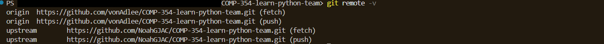
*Anis' Upstream*

### Understanding `origin` vs `upstream`

In a forked repository workflow, two distinct remotes are used:

| Remote | Purpose |
|--------|---------|
| `origin` | Points to the student's own GitHub fork. Used for `git push` to send local commits to their fork, and `git fetch` to pull changes from their fork. |
| `upstream` | Points to the original repository (the maintainer's repo). Used to pull in upstream changes that are not yet in the fork. |

Key differences:

- **`origin`** is the student's personal copy on GitHub. Pushes go here; pulls from here come back to the local machine.
- **`upstream`** is the canonical repository maintained by Student A. The student can only read from it (fetch), never push to it directly. Changes must flow through pull requests.

### Step 3 — Synchronize the Forks

After the initial forks were created:

1. Student A made a small update to the project's README and pushed the change to the original repository.
2. Students B and C synchronized their local repositories and GitHub forks with the updated original repository.
3. Each student verified that the README update was available in their fork.

### Synchronization Process

Synchronization was performed using the following commands:

```bash
# Fetch changes from upstream
git fetch upstream

# Merge upstream changes into the local main branch
git merge upstream/main

# Push the updated local main branch to the student's fork (origin)
git push origin main
```

---

## 5. Part B — Collaborative Development and Pull Requests

Student A (`src/data_types/test_lists.py`):

*Noah's PR*

Student B (`src/data_types/test_dictionaries.py`):

*Daniel's PR*

Student C (`src/control_flow/test_if.py`):

*Anis's PR*

Student D (`src/functions/test_function_definition.py`):

*Noah's 2nd PR*

### Development Requirements

Each student:

1. Created a separate development branch for the assigned task.
2. Examined the existing code and followed its general structure and conventions.
3. Implemented the assigned improvements.
4. Added appropriate assertions or tests that demonstrated the expected behavior.
5. Executed the relevant tests and verified that the changes work correctly.
6. Created at least two meaningful commits describing the development work.

### Code Review Requirements

For all four pull requests:

1. Another team member reviewed the proposed changes.
2. The reviewer inspected the modified files.
3. The reviewer provided one meaningful review comment.
4. Any identified issues were addressed before merging.
5. The team merged the contributions into the original repository.

---

## 6. Part C — Merge Conflict Challenge (30%)


### Conflict 1 — Command-Line Resolution

**Participants:** Students A and B  
**Used the existing file:** `src/data_types/test_lists.py`

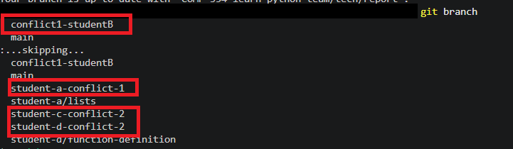
*Separate Branches for Conflict 1 & 2*

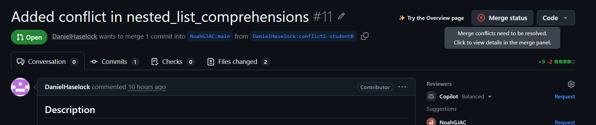
*Github Merge Conflict*

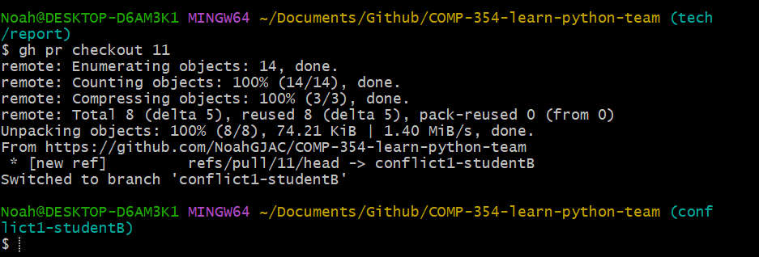
*Git Bash Checkout*

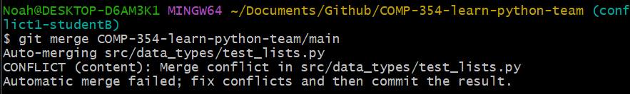
*Git Bash Merge Conflict*


*Conflict 1 Conflict Markers*

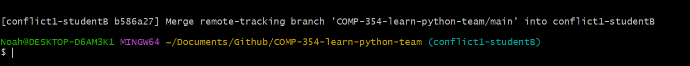

*Git Bash Merge And Push*


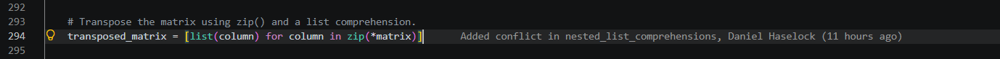
*Main Branch with Noah's & Daniel's Changes*

### Conflict 2 — GUI Resolution

**Participants:** Students C and A
**Used the existing file:** `src/control_flow/test_if.py`


*VSCode Git Extension Conflict*

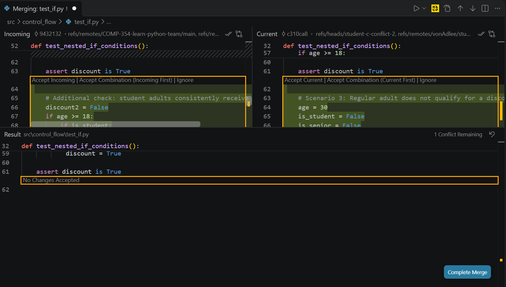
*VSCode Merge Editor*

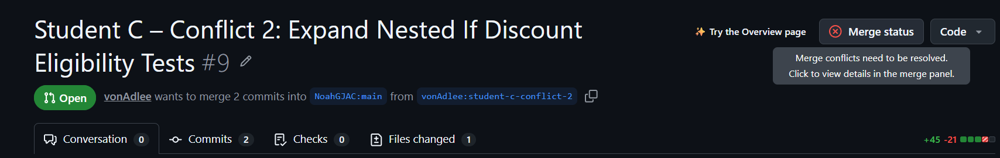
*Github Merge Conflict*


*VSCode Stashed Changes After Merge*


*Main Branch with Noah's & Anis' Changes*

For both conflicts, Git could not automatically merge the changes because both branches modified the exact same lines of code with different changes. Git doesn't know which version should be kept, or both. Therefore it hands the final decision over to the user to determine how the merge conflict should be handled.

The resolution process was the following:
1. Inspect the merge conflict.
2. Edit the files with a merge editor or by using the conflict markers.
3. Test the changes to verify the required functionality was preserved.
4. Stage the merge resolution
5. Commit and push the merge

Demonstrate that the modified tests execute successfully:
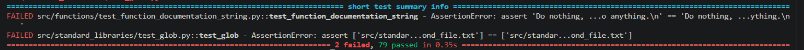
*Results of Pytest.*
**Note: The only failing tests were existing failures in the project, not changes by us. All of our tests passed (79/81).**

---

## 7. Part D — Final Verification and SCM Report (15%)

After all contributions and conflict resolutions have been integrated, the team must perform a final verification.

### Step 1 — Verify the Integrated Project
TODO:
The team must:


1. Confirm that all four students' improvements are present in the original repository.
2. Verify that the two conflict resolutions did not remove any required functionality.
3. Confirm that the final version is available on the `main` branch of Student A's repository.

### Student C (vonAdlee) Nested If Conditions and conflict 2

1. Contribution to the project

Student C (Anis Alouache) worked on the file src/control_flow/test_if.py, specifically the function test_nested_if_conditions()

Expanded the original test to include Adult discount, Senior Customer, Regular Adult, and Minor students

2. Conflict 2 – Merge Conflict Resolution

Conflict 2 involved Student C and Student D modifying the same function, test_nested_if_conditions(), in src/control_flow/test_if.py.

Both students started from the agreed commit e50863e and independently implemented their changes.\

Student C introduced additional discount eligibility scenarios, while Student D added an additional discount2 check to verify that adult students consistently receive a discount.

The changes were integrated while preserving both contributions.

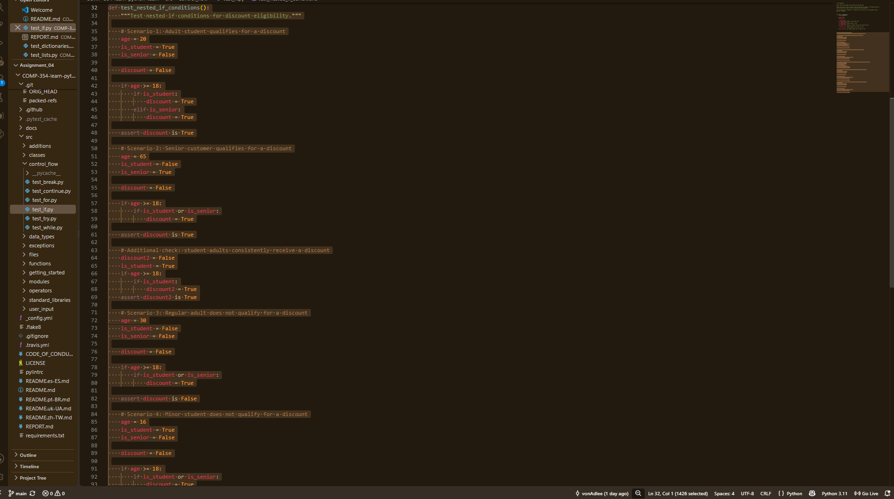 Final nested if function after conflict resolution

3. Verification of the Final Implementation

The final version of src/control_flow/test_if.py was inspected directly from the original repository's main branch using:

```bash

git show upstream/main:src/control_flow/test_if.py
```

The Git history was also inspected using:

```bash

git log upstream/main --oneline -- src/control_flow/test_if.py
```

 Git Commit History Showing Student C and Student D's Contributions to Conflict 2


4. Confirmation of the Final Main Branch

The final integrated version was confirmed on Student A's original repository.

The following command was executed:

```bash
git log upstream/main -1 --oneline
```

The output was:

```bash
0f20afa (tag: v1.0.0, upstream/main, upstream/HEAD, origin/main, origin/HEAD, main) Merge pull request #5 from NoahGJAC/student-a/lists
```

This confirms that the local main, Student A's original upstream/main, and the fork's origin/main all point to the same final commit, tagged v1.0.0

### Step 2 — Examine the Git History

```bash
git log --oneline --decorate --graph --all
```

The results can be seen below or in `docs/git_log.txt`:
```
* 21832e3 (COMP-354-learn-python-team/tech/report, tech/report) Conflict 2 report
* cae048d report for conflict 1
* bf7adf7 add pr screenshots, update report
* 20a4270 add CLI & GUI merge screenshots
* 1a908c8 add conflict screenshots
* 4ea400e update report
* c46ec22 step 2 & 3
| *   0f20afa (HEAD -> main, COMP-354-learn-python-team/main, COMP-354-learn-python-team/HEAD) Merge pull request #5 from NoahGJAC/student-a/lists
| |\  
| | * b5657ab (COMP-354-learn-python-team/student-a/lists, student-a/lists) add list concat and replication
| | * 3120587 add list examples
| * |   ceacfb3 Merge pull request #9 from vonAdlee/student-c-conflict-2
| |\ \  
| | * \   f36e8c6 (vonAdlee/student-c-conflict-2, student-c-conflict-2) Merge branch 'main' into student-c-conflict-2
| | |\ \  
| | |/ /  
| |/| |   
| * | |   9432132 Merge pull request #11 from DanielHaselock/conflict1-studentB
| |\ \ \  
| | * \ \   b586a27 (conflict1-studentB) Merge remote-tracking branch 'COMP-354-learn-python-team/main' into conflict1-studentB
| | |\ \ \  
| | |/ / /  
| |/| | |   
| * | | |   2508855 Merge pull request #8 from NoahGJAC/student-d-conflict-2
| |\ \ \ \  
| | * | | | 0a41171 (COMP-354-learn-python-team/student-d-conflict-2, student-d-conflict-2) additional check tfor age discount
| |/ / / /  
|/| | | |   
| * | | |   e8f8146 Merge pull request #12 from NoahGJAC/student-a-conflict-1
| |\ \ \ \  
| | * | | | 6d21eed (COMP-354-learn-python-team/student-a-conflict-1, student-a-conflict-1) change transpose logic
| * | | | | ec1485e Merge pull request #7 from NoahGJAC/student-a-conflict-1
|/| | | | | 
| |/ / / /  
| * / / / e51b75c add an assert
|/ / / /  
| * / / 9340791 Added conflict in nested_list_comprehensions
|/ / /  
| * | c310ca8 Expand nested discount eligibility tests
| * | 179ab84 Add senior discount eligibility test
|/ /  
* |   e50863e Merge pull request #3 from DanielHaselock/student-b/dictionary-operations
|\ \  
| * | a27c9fa Add safe dictionary retrieval and removal examples with validation notes
| * | 95f5166 Add dictionary update example for existing and new keys
| |/  
* |   4fe798b Merge pull request #6 from vonAdlee/student-C/conditional-examples
|\ \  
| * | c8d3f71 (vonAdlee/student-C/conditional-examples) Add nested if
| * | 63d2460 Add elif conditional examples
| |/  
* |   ba04dea Merge pull request #4 from NoahGJAC/student-d/function-definition
|\ \  
| |/  
|/|   
| * aa34629 (COMP-354-learn-python-team/student-d/function-definition, student-d/function-definition) add *arg method
| * 04c3f42 add function tests
|/  
*   fbe6781 Merge branch 'main' of https://github.com/NoahGJAC/COMP-354-learn-python-team
|\  
| *   f82bfec Merge pull request #2 from vonAdlee/main
| |\  
| | * 15b4d24 (vonAdlee/main, vonAdlee/HEAD) Merge pull request #1 from vonAdlee/documents/screenshots
| |/| 
| | * 83f5442 (vonAdlee/documents/screenshots) Add files via upload
| |/  
* / f08d438 small changes
|/  
*   4a51efd Merge pull request #1 from DanielHaselock/main
|\  
| * 40c6dc4 add upstream screenshot
|/  
* f225a01 add report and pull request template
* fa8f9dd initizalize repo with learn-python files
```

Breakdown of major contributions and merges from the git history:

#### Branches
- `main`

- `student-a/lists` — NoahGJAC
-  `student-a-conflict-1` — NoahGJAC
- `student-c-conflict-2` — vonAdlee
- `conflict1-studentB` — DanielHaselock
- `student-d-conflict-2` — NoahGJAC
- `student-d/function-definition` — NoahGJAC

#### Major feature merges into main
| PR | Branch | Author |
|----|--------|--------|
| #5 | `student-a/lists` | NoahGJAC | 
| #4 | `student-d/function-definition` | NoahGJAC |
| #6 | `student-C/conditional-examples` | vonAdlee |
| #3 | `student-b/dictionary-operations` | DanielHaselock |

#### Conflict-resolution merges into main
| PR | Branch | Author |
|----|--------|--------|
| #12 | `student-a-conflict-1` | NoahGJAC | 
| #8 | `student-d-conflict-2` | NoahGJAC | 
| #9 | `student-c-conflict-2` | vonAdlee |
| #11 | `conflict1-studentB` | DanielHaselock | 

#### Conflict-introducing commits
- `9340791` — "Added conflict in nested_list_comprehensions" (student-a-conflict-1)
- `c310ca8` — "Expand nested discount eligibility tests"
- `179ab84` — "Add senior discount eligibility test"
- `0a41171` — "additional check for age discount" (student-d-conflict-2)

### Step 3 — Create a Release Tag

Tagged Release found here: [https://github.com/NoahGJAC/COMP-354-learn-python-team/releases/tag/v1.0.0](https://github.com/NoahGJAC/COMP-354-learn-python-team/releases/tag/v1.0.0)

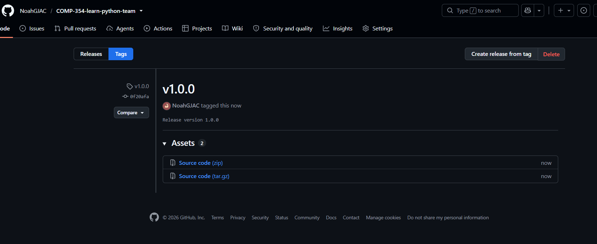
*Tagged Release*

### Step 4 — Prepare the SCM Report

# Team Practical Work & SCM Report

## GitHub Collaboration

12 pull requests total, 11 merged and 1 closed:

| PR | Branch | Author | Merged Into | Content |
|----|--------|--------|-------------|---------|
| #1 | main | DanielHaselock | main | upstream screenshot |
| #2 | main | vonAdlee | main | screenshots added |
| #3 | student-b/dictionary-operations | DanielHaselock | main | dict update, retrieval, removal |
| #4 | student-d/function-definition | NoahGJAC | main | `*arg` method + function tests |
| #5 | student-a/lists | NoahGJAC | main | list examples, concat & replication |
| #6 | student-C/conditional-examples | vonAdlee | main | `elif` + nested `if` |
| #7 | student-a-conflict-1 | NoahGJAC | main | transpose matrix assertion |
| #8 | student-d-conflict-2 | NoahGJAC | main | age discount check |
| #9 | student-c-conflict-2 | vonAdlee | main | nested if discount eligibility tests |
| #11 | conflict1-studentB | DanielHaselock | main | nested_list_comprehensions conflict resolution |
| #12 | student-a-conflict-1 | NoahGJAC | main | Student-A conflict 1 |
| #10 | conflict-1-student-b | DanielHaselock | main | **CLOSED** (not merged) |

Each student created a separate development branch, made ≥2 meaningful commits, added assertions/tests, and underwent code review before merging.

## Conflict Resolution

**Conflict 1 (CLI) — `src/data_types/test_lists.py`, Students A & B**
- Both branches edited the same lines; Git could not auto-merge.
- Resolved via Git Bash: inspected conflict markers, edited manually, staged, committed, pushed (PR #11, Daniel; PR #12, Noah).

**Conflict 2 (GUI) — `src/control_flow/test_if.py`, Students C & A**
- Same file, overlapping changes; resolved using VS Code's merge editor (PR #9, Anis).

Resolution process for both: inspect conflict → edit with merge editor/markers → test → stage → commit → push.

## Final Verification

Ran the full pytest suite on `src/`:

```
79 passed, 2 failed
```

The 2 failures are pre-existing issues unrelated to the team's changes:
- `test_function_documentation_string.py`
- `test_glob.py` 

### Final Results

**Improvements**
- List concat/replication examples (`test_lists.py`)
- `*arg` function method + tests (`test_function_definition.py`)
- dictionary update, safe retrieval/removal with validation notes (`test_dictionaries.py`)
- `elif` and nested `if` conditional examples (`test_if.py`)

**Testing results**
- Full `pytest` run on `src/`: **79 passed, 2 failed**.

**Student contributions**
- **Noah (NoahGJAC, Student A + D):** repo maintainer; lists examples + concat/replication; `*arg` method + function tests; conflict-1 and conflict-2 resolutions.
- **Daniel (DanielHaselock, Student B):** dictionary operations; conflict-1 resolution via CLI.
- **Anis (vonAdlee, Student C):** `elif`/nested `if` conditionals; conflict-2 resolution via VS Code GUI merge editor.

**Challenges**
- Two deliberate merge conflicts on the same files (`test_lists.py`, `test_if.py`) requiring manual resolution — Conflict 1 via Git Bash/CLI, Conflict 2 via VS Code GUI merge editor.
- One PR (#10, Student B conflict-1) was closed, not merged; the resolution was re-submitted as PR #11.
- Pre-existing test failures.